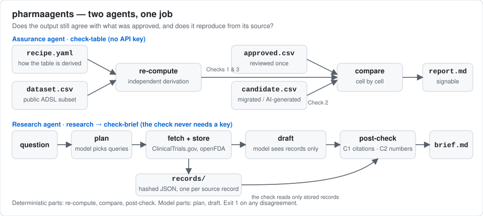
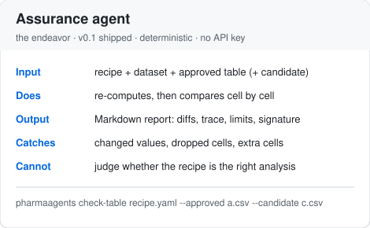
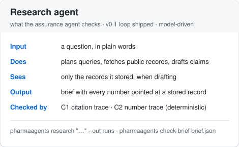
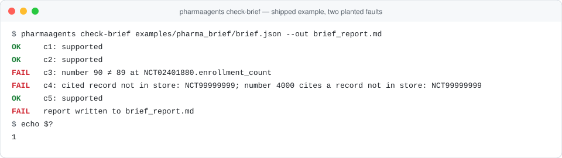
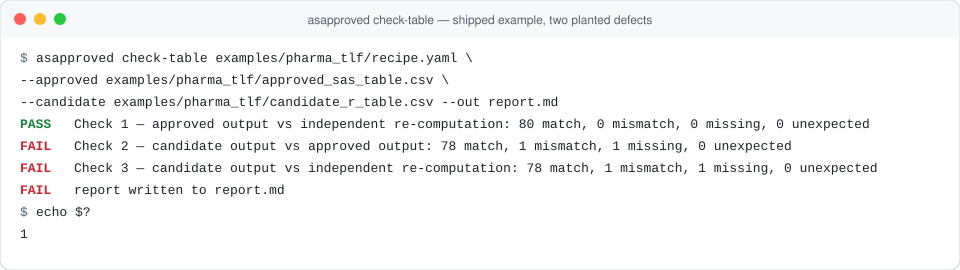
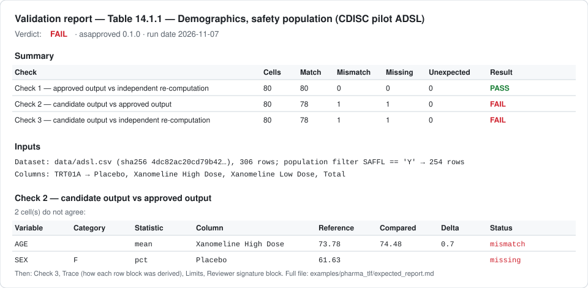

# pharmaagents

**Check that an automated analysis still does what it was shown to do when it was approved.**

An analysis output gets reviewed and approved once. Then the code is migrated, an AI assistant
re-writes it, the data refreshes, and the output keeps looking confident. `pharmaagents` re-computes
the output independently from its source and recipe, compares the approved and the new output cell
by cell, and writes a report a reviewer can read, sign and date. The first worked example is a
clinical-trial demographics table built on public CDISC pilot data.

> **Scope and disclaimer.** `pharmaagents` is a research and education tool. It is not a validated
> system under 21 CFR Part 11 or GAMP 5, it is not endorsed by the FDA or any regulator, and it is not
> medical advice. It uses public data only; never give it patient or employer data. Validation of a
> system for regulated use is something your organisation does under its own procedures; this tool
> can support that work but cannot perform it. See [docs/REGULATORY_CONTEXT.md](docs/REGULATORY_CONTEXT.md)
> and [docs/LIMITS.md](docs/LIMITS.md).

## How it works



Two agents, one job. What each check computes, step by step, is in [docs/METHOD.md](docs/METHOD.md).

<table><tr>
<td></td>
<td></td>
</tr></table>

### Assurance agent (v0.1 — shipped, no API key needed)
Given a **recipe** (how a table is derived) and a **dataset**, it:
1. re-computes the table from source, the way a second programmer would;
2. compares the **approved** output against that re-computation;
3. compares a **candidate** output (migrated code, AI-generated code, a refreshed run) against both;
4. writes a Markdown report: summary, every disagreeing cell, a trace of each derivation, limits,
   and a signature block.

### Research agent (loop shipped; re-run baseline and drift flag in v0.2)
Answers a question from public sources only (ClinicalTrials.gov, openFDA, PubMed) and produces a
brief in which every number and claim points at a stored source record. The assurance agent then
checks that brief the same way it checks a table, and a baseline of re-runs lets it flag change
beyond normal day-to-day variation.

Shipped so far: the loop itself (`pharmaagents research`: plan → fetch → draft → post-check, about a
hundred lines in `pharmaagents/research/agent.py`), the provider interface (`pharmaagents/llm/`, one
`complete()` call; Anthropic and a scripted fake), the source adapters with stored, hashed records
(`pharmaagents/sources/`: ClinicalTrials.gov API v2, openFDA labels and FAERS counts), and the
deterministic post-check (`pharmaagents check-brief`). The model sees only the records the adapters
stored; the check then resolves every citation and every number back to a stored record. What each
adapter stores and under which terms: [docs/DATA_SOURCES.md](docs/DATA_SOURCES.md). A worked
example with two deliberate faults: [examples/pharma_brief](examples/pharma_brief/README.md).
Still to come: the re-run baseline and drift flag.



## Start using

| You want to | Run |
|---|---|
| See it work on the shipped example | `pharmaagents check-table examples/pharma_tlf/recipe.yaml --approved examples/pharma_tlf/approved_sas_table.csv --candidate examples/pharma_tlf/candidate_r_table.csv` |
| Create an approved baseline from a recipe | `pharmaagents recompute my_recipe.yaml --out approved.csv` |
| Check a new output against it | `pharmaagents check-table my_recipe.yaml --approved approved.csv --candidate new.csv --reviewer "Name, Role (personal capacity)"` |
| Check the shipped example brief (no key, no network) | `pharmaagents check-brief examples/pharma_brief/brief.json` |
| Answer a question from public records and check the brief | `pharmaagents research "What do public records say about X?" --out runs` (needs `pharmaagents[llm]` and an Anthropic credential) |
| Leave a public record of your run | [docs/ADOPTER_WORKFLOW.md](docs/ADOPTER_WORKFLOW.md) |

Exit code `0` = all checks pass; `1` = at least one cell disagrees or one claim is unsupported.

## Worked example: a demographics table, approved vs re-implemented

`examples/pharma_tlf/` holds a recipe (safety population, by actual treatment, AGE summary and
SEX/RACE/age-group counts), a column subset of the public CDISC pilot **ADSL** dataset (via
[pharmaverseadam](https://github.com/pharmaverse/pharmaverseadam), Apache-2.0), an approved table,
and a candidate table with two deliberate defects. The expected report is checked in:
[examples/pharma_tlf/expected_report.md](examples/pharma_tlf/expected_report.md).





The images are SVG generated from the real CLI output and report by `assets/make_assets.py`; a
test keeps them in step with the code.

## Install

```bash
pip install pharmaagents            # library + CLI
pip install 'pharmaagents[data]'    # + pyreadr, to re-export the pilot data from upstream
pip install 'pharmaagents[llm]'     # + the Anthropic SDK, for the research agent (the checks never need it)
```
Python 3.11 or later. Development: `uv sync --extra dev && uv run pytest`.

## Table format

Tables are **long**: one row per cell, columns `variable, category, statistic, group, value`. Export
from SAS or R in that shape and the comparison works regardless of the language that produced it.

## Who uses it

See [ADOPTERS.md](ADOPTERS.md). Add a row by pull request after filing a
[validation report](.github/ISSUE_TEMPLATE/validation-report.yml).

## Tests

`uv run pytest`: unit tests for re-computation, comparison, the provider interface, the source
adapters (on captured fixtures), the research loop (with the scripted provider) and the post-check;
golden tests that both shipped examples reproduce their expected reports byte for byte. CI sets
`PHARMAAGENTS_OFFLINE=1` and never calls a network or a language model; live smoke tests run only
with `PHARMAAGENTS_LIVE=1`.

## AI disclosure, citation, licence

Built with AI assistance and reviewed line by line: [AI_DISCLOSURE.md](AI_DISCLOSURE.md).
Cite with [CITATION.cff](CITATION.cff). Apache-2.0, see [LICENSE](LICENSE) and [NOTICE](NOTICE).
